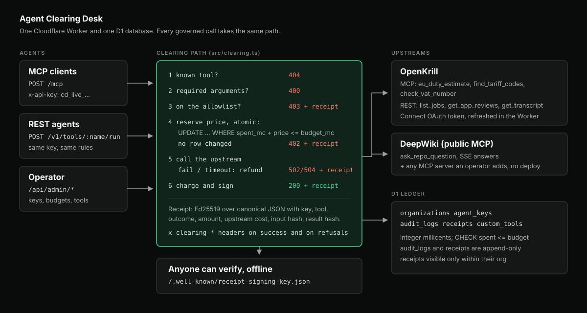

# Agent Clearing Desk

A spend gate for AI agents that call paid tools.
Each agent gets its own key with a hard budget, a tool allowlist and an optional daily or monthly reset.
Every call is cleared before it runs and returns a receipt that anyone can verify offline.

- Live desk and judge sandbox: https://agent-clearing-desk.nguyenhieuec.workers.dev
- MCP endpoint: https://agent-clearing-desk.nguyenhieuec.workers.dev/mcp
- Public signing key: https://agent-clearing-desk.nguyenhieuec.workers.dev/.well-known/receipt-signing-key.json
- Source: https://github.com/nguyenhieuec/agent-clearing-desk
- Pitch video (3:49): https://youtu.be/aVK8SuRTMSU

## The problem

Teams want agents to call paid data APIs: customs duty, VAT registries, job feeds, code search.
Today the agent usually holds the master API key.
Then one retry loop can spend the whole quota, the agent can call any tool on that account, and finance has no record that ties a charge to an agent and an input.

## What the desk does

The desk sits between agents and the upstream tools, over REST (`POST /v1/tools/:name/run`) and MCP (`/mcp`).
Upstream credentials stay in the Worker; agents only hold scoped `cd_live_` keys, stored as SHA-256 hashes.
For OpenKrill the desk is a Connect OAuth client: it refreshes its 1 hour access token itself and keeps the rotating refresh token in D1.

For each call the desk runs one path:

1. Unknown tool: 404.
   Arguments that break the tool's input schema (type, required, pattern, length, enum, unknown field): 400 with the list of problems.
   Nothing is written or charged, and the upstream is never called.
2. Tool not on the key's allowlist: 403, a signed receipt, no upstream call.
   After 20 failed upstream calls on one key in the current UTC hour, the next call gets 429 `too_many_failed_calls` before the upstream is called, so free failures cannot be used to hammer an upstream.
   A failure caused by the operator's own upstream credential (401 or 403) does not count against the agent.
3. Reserve the price with one conditional SQL `UPDATE ... WHERE spent_mc + price <= budget_mc`.
   If no row changes, the call gets 402 and a signed receipt.
   This is atomic: 20 concurrent calls on a key with room for one give exactly one success in the tests, and 10 concurrent calls on the live desk gave 1 x 200 and 9 x 402.
4. Call the upstream. If it fails (502), is slower than the tool's timeout (504) or refuses the arguments (400), the reservation is refunded in the same batch that writes the receipt.
   An MCP upstream refuses a call with `isError` and a coded text such as `invalid_input: ZZ is not a VIES country`; codes that blame the input (`invalid_*`, `bad_*`, `not_found`, `too_large`, `blocked_url`) give 400, any other tool error gives 502.
   The refund goes back only to the budget period it was taken from, so a call that started before midnight and failed after it cannot give the new day extra room.
5. On success, the desk charges the price and signs the receipt.

Every receipt is Ed25519 over a canonical JSON payload.
The payload holds the key, org, tool, upstream, outcome, HTTP status, amount, upstream cost, a SHA-256 of the input and a SHA-256 of the result.
Both hashes are over canonical JSON (keys sorted at every level), so the same arguments in another key order still match.
Anyone with the public key can check a response with no call to the desk: `node scripts/verify-receipt.mjs response.json public-key.json --input args.json`.
The script checks 4 things: the signature, that the SHA-256 of the returned result is the signed `result_sha256`, that the SHA-256 of the arguments you sent is the signed `params_sha256`, and that the readable `unsigned_view` copy says the same as the signed `payload`.
So a receipt proves which answer was paid for, not only that a charge happened.
If a file has the receipt but not the result, the script says so (`proves_answer: false`) instead of passing it silently.
Over MCP the whole signed receipt rides in the `tools/call` result next to the answer, so an MCP client can check it with no second call; `get_call_receipt` also checks the signature on the desk.
The browser demo runs the same signature and result checks with WebCrypto.
Changing one digit of the amount, or one character of the result, makes the check fail.

Money is integer millicents (1/1000 of a cent), and a CHECK constraint makes `spent > budget` impossible even outside the reservation path.
A key's budget can be one-off, daily or monthly (UTC).
A periodic budget starts again from 0 inside the same atomic reservation, so a reset never lets parallel calls overspend.
Every response that carries a receipt (200, 402, 403 and upstream errors) and `/v1/usage` show `budget_period` and `resets_at`.
Database triggers make the audit log and the receipts append-only.
A receipt is visible only to keys of the same organization.

## Any MCP server, one gate

| Upstream | Protocol | Tools |
| --- | --- | --- |
| OpenKrill | MCP plugins | `eu_duty_estimate`, `find_tariff_codes`, `check_vat_number` |
| OpenKrill | REST | `list_jobs`, `get_app_reviews`, `get_transcript` |
| DeepWiki (public) | MCP, SSE answers | `ask_repo_question` |

Arguments pass through unchanged once they fit the schema.
Each tool's description in `tools/list` states its price per successful call.
Input schemas are copied from the upstreams by `scripts/sync-tool-schemas.mjs`.
There is no fallback data: if the upstream fails, the agent gets an error and pays nothing.
Two free desk tools, `check_agent_balance` and `get_call_receipt`, let an agent see where it stands.

An operator can put a tool from any public MCP server behind the gate with one admin call, or the **Add a tool** form in the console, with no deploy:

```bash
curl -X POST $DESK/api/admin/tools -H "authorization: Bearer $ADMIN_SECRET" -H 'content-type: application/json' \
  -d '{"name":"repo_topics","mcpUrl":"https://mcp.deepwiki.com/mcp","upstreamTool":"read_wiki_structure","costCents":0,"priceCents":0.5}'
```

The desk runs the MCP lifecycle with that server (`initialize`, then `notifications/initialized`, keeping the `mcp-session-id`), reads its own `tools/list`, keeps the input schema it finds there, and refuses a plain `http` URL, a bad name or a name taken by a built-in tool.
For a paid server the operator adds one credential header (`authorization` or an `x-` header).
The desk seals it with AES-256-GCM under its `UPSTREAM_SECRET_KEY`, bound to the tool name, opens it only to make a call, and never returns it: the tool list shows `authorization header, sealed`.
The new tool shows up in `tools/list` at once and takes the same clearing path; `POST /api/admin/tools/:name/disable` takes it out again.
The live e2e run adds a DeepWiki tool this way, clears calls on a daily key, proves the answer offline, and disables it; then it adds a second one with a sealed header and clears a call through it.

`cost` is the contract rate the operator sets per call for an upstream; the desk does not read a bill from the upstream.

## Who operates it

- Operator: an admin API behind a bearer secret (`/api/admin/*`) creates organizations and keys, sets budgets, allowlists and per-key prices, rotates and revokes keys, and reads the audit log with upstream cost, price and margin per call.
- Agent: can rotate its own key (`POST /v1/key/rotate`); the old secret stops at once, spend is kept.
- Judge: `POST /api/demo/keys` gives anyone a sandbox key with a 2 cent budget, 2 allowed tools and a 60 minute life. Each sandbox key gets its own organization, so one judge cannot read another judge's receipts. The whole sandbox is capped at 100 keys per UTC day, and one network at 5 keys per day, by conditional SQL counters, so one script cannot drain the upstream account or use up the day for every judge. The per-network counter stores a SHA-256 of the IP and the day, never the IP itself.

## Architecture



One TypeScript Cloudflare Worker with no runtime dependencies, and one D1 database with 5 ledger tables (`organizations`, `agent_keys`, `audit_logs`, `receipts`, `usage_events`) one for the upstream token (`upstream_credentials`), one for tools added at run time (`custom_tools`) and one for the daily sandbox cap and the failed-call cap (`desk_counters`).

| File | Job |
| --- | --- |
| `src/clearing.ts` | The one clearing path for REST and MCP |
| `src/db.ts` | Atomic reservation, ledger batch, readers |
| `src/crypto.ts` | Key hashing, Ed25519 signing and verification |
| `src/upstream.ts` | MCP (JSON or SSE, with session; only the SSE message with the request id counts; the session is closed after each call) and REST upstream calls, timeouts |
| `src/json-schema.ts` | Argument check against the tool's input schema |
| `src/sealed-secret.ts` | AES-256-GCM sealing of upstream credentials |
| `src/openkrill-auth.ts` | OpenKrill Connect token refresh, rotating refresh token in D1 |
| `src/tools.ts` | Built-in governed tools, cost and price per call |
| `src/tool-registry.ts` | Tools an operator adds from any MCP server at run time |
| `src/budget-period.ts` | Daily and monthly budget periods |
| `src/proxy.ts`, `src/mcp.ts` | REST and MCP front doors |
| `src/admin.ts` | Operator API and the capped public sandbox |
| `public/` | Judge sandbox and operator console |

## How it compares

Checked against the source of each project on 2026-10-20.

| | LiteLLM Proxy | Helicone | Agent Clearing Desk |
| --- | --- | --- | --- |
| Main job | LLM routing for many providers | LLM observability | Spend gate for paid agent tools |
| Per-key budget | Yes, also counts MCP tool calls | Yes, cost limits answer 429 | Yes, reserved atomically before the call |
| Per-key MCP tool allowlist | Yes | No | Yes |
| Budget that resets daily or monthly | Yes (`budget_duration`) | Yes, per time window | Yes, inside the atomic reservation |
| Budget holds under parallel calls | Not documented | Not documented | Yes, one conditional update; 10 parallel calls on the live desk gave 1 x 200 |
| Refund when the upstream fails or times out | Not documented | Not documented | Yes, same batch as the receipt, to the period it came from |
| Argument check before any spend | No | No | Yes, against the upstream's own schema |
| Signed per-call receipt, verifiable offline | No | No | Yes, Ed25519, also for refusals |
| Upstream cost vs price per call | Spend only | Cost only | Cost (a configured rate), price and margin |
| Providers, dashboards, SSO, caching | Many, mature | Many, mature | No: one Worker, a small console |

LiteLLM and Helicone do far more for LLM traffic.
The desk is narrower: it is the money and proof layer for tool calls, and it can sit beside them.

## Evidence

- `npm test`: 51 tests on real SQLite (`node:sqlite`) with the same migrations as production. Only the upstreams and the OpenKrill token endpoint are faked.
- [`e2e-live-output.json`](./e2e-live-output.json): 43 of 43 live checks against the deployed desk, with real upstream calls, including an upstream refusal mapped to 400 with nothing spent, the 429 after 20 failed calls, a tool added at run time, one with a sealed credential, a 400 on bad arguments before any charge, the in-band MCP receipt and the 4-part offline proof.
- [`judge-steps.md`](./judge-steps.md): what a judge can repeat in a browser or with curl.
- [`checklist.md`](./checklist.md): requirement mapping.
